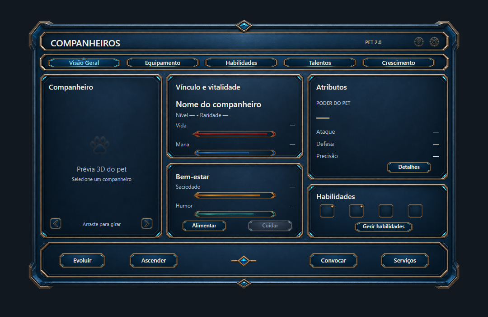
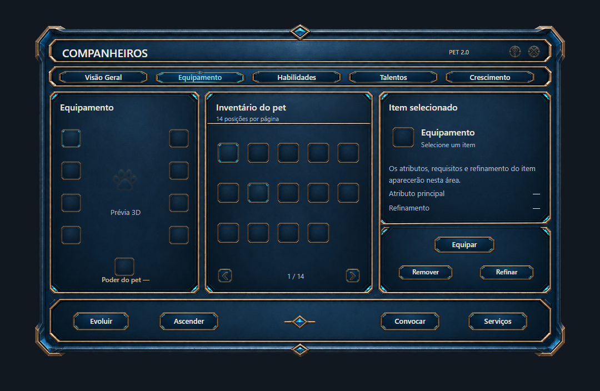
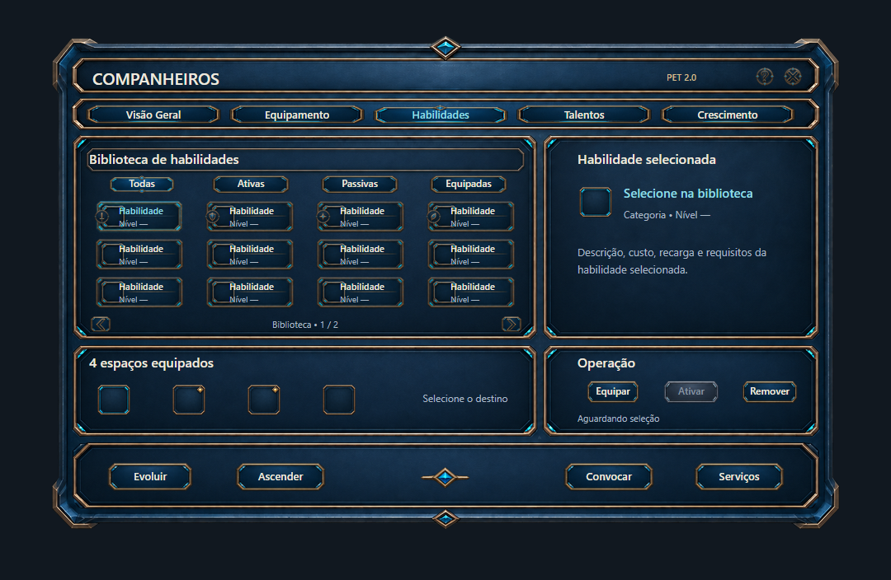
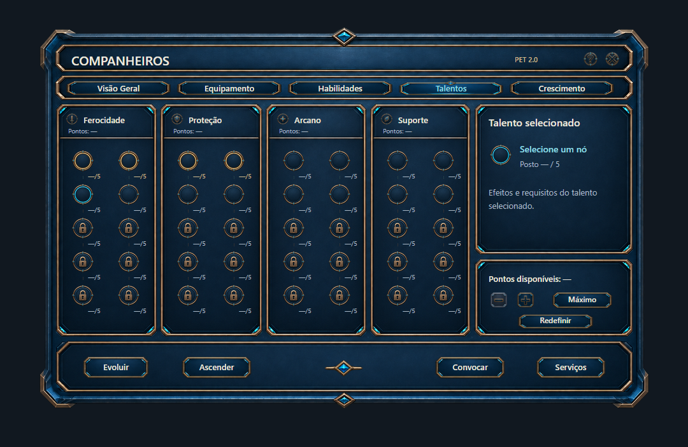
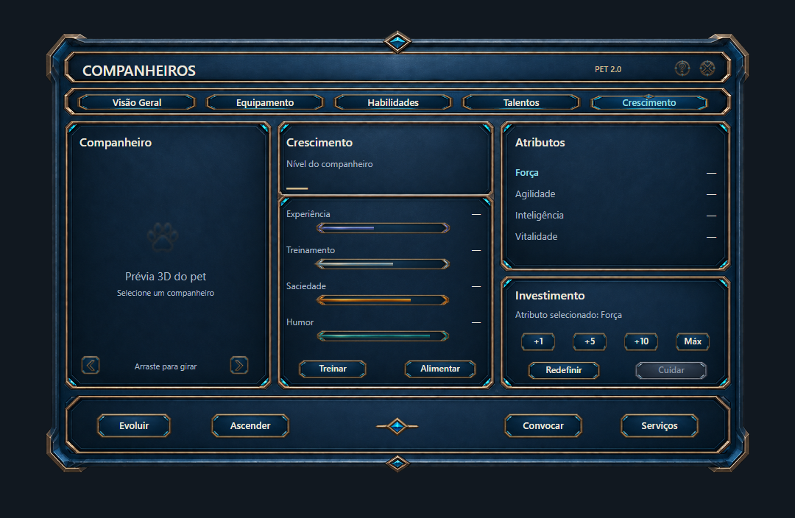
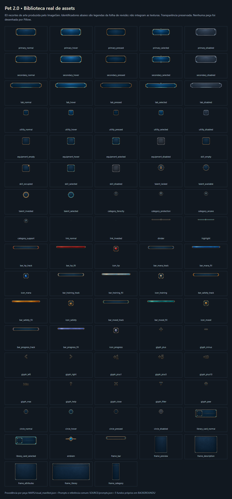
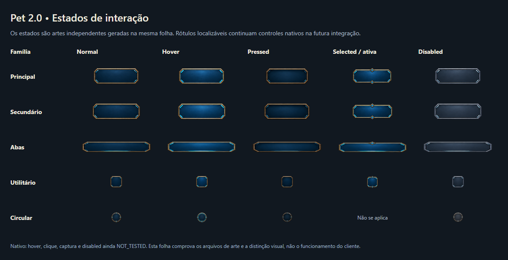

# Forsaken World Dimension — HUD Pet 2.0
Galeria **privada** para revisão visual, com os PNGs originais produzidos pelo Codex em 20/10/2026. Sem modificação dos arquivos do jogo.

Clique em cada imagem para ampliá-la. As cinco primeiras são composições visuais, **não são capturas do jogo**.

## 1. Visão Geral

## 2. Equipamento

## 3. Habilidades

## 4. Talentos

## 5. Crescimento

## Biblioteca de componentes

## Estados dos botões

**Status:** arte/concepção e matriz de controles mapeados; integração XML/C++, build e gameplay pendentes.